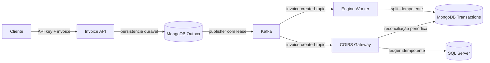

# Split Payment Platform

[](LICENSE)

Plataforma demonstrativa para ingestão e processamento assíncrono de invoices, com API .NET, Kafka, MongoDB e SQL Server. O repositório demonstra validação de entrada, publicação resiliente, idempotência, persistência em dois destinos, reconciliação e execução containerizada.

**Autor:** [VniiD](https://github.com/VniiD)
**Licença:** [GNU GPL-3.0-only](LICENSE)

> **Simulação técnica.** Este software não autoriza nem realiza recolhimento tributário oficial. Alíquotas, arredondamento e referências legais são ilustrativos e precisam de validação jurídica e de negócio antes de qualquer uso real.

## Arquitetura



| Componente | Responsabilidade |
|---|---|
| `SplitPayment.InvoiceApi` | Autenticação por `X-API-Key`, validação, rate limit, idempotência HTTP e consulta do status de publicação |
| MongoDB `InvoiceOutbox` | Aceite durável, hash da requisição e fila de publicação com lease e retry limitado |
| Kafka | Evento versionado `InvoiceCreatedEvent`, chaveado por CNPJ do fornecedor |
| `SplitPayment.EngineWorker` | Calcula o split e grava em `Transactions` com `InvoiceId` único |
| `SplitPayment.CgibsGateway` | Grava o ledger SQL e compara periodicamente os dois destinos |

A entrega é *at-least-once*. Uma falha entre a confirmação do Kafka e a atualização do outbox pode publicar novamente; os consumidores tornam o efeito de persistência idempotente por `InvoiceId`. Cada consumer usa seu próprio grupo e DLQ.

## API

`POST /api/v1/invoices` exige os headers:

| Header | Regra |
|---|---|
| `X-API-Key` | Chave configurada fora do código; comparação em tempo constante |
| `Idempotency-Key` | 8 a 128 caracteres ASCII alfanuméricos, `.`, `_` ou `-` |

Corpo:

```json
{
  "merchantTaxId": "11.222.333/0001-81",
  "customerTaxId": "529.982.247-25",
  "grossAmount": 1000.00,
  "ibsRate": 17.7,
  "cbsRate": 8.8,
  "isSimplifiedProcedure": false
}
```

`202 Accepted` significa que o evento foi gravado no outbox com write concern majority; a publicação Kafka pode ainda estar pendente. Repetir a mesma chave e conteúdo retorna o mesmo `invoiceId`; reutilizar a chave com conteúdo diferente retorna `409`. A rota `GET /api/v1/invoices/{invoiceId}` consulta o estado e exige a mesma chave de API.

- `400`: documento, valor, alíquota ou chave de idempotência inválida.
- `401`: chave de API ausente ou inválida.
- `409`: chave de idempotência reutilizada com outro conteúdo.
- `429`: limite de 30 requisições por minuto por IP.
- `503`: não foi possível aceitar a invoice duravelmente.

OpenAPI: `GET /openapi/v1.json`. Health checks: `GET /health/live` e `GET /health/ready`; readiness verifica MongoDB e Kafka.

## Execução local

Requisitos: Docker Engine com Docker Compose v2; .NET 10 SDK apenas para desenvolvimento e testes fora dos containers; `openssl`, `curl` e `node` para os passos abaixo. O Compose executa os serviços .NET, Kafka em KRaft, MongoDB 7 e SQL Server 2022 Developer. .NET 10 é a linha LTS usada pelo projeto; mantenha SDK/runtime no último patch suportado.

1. Gere um `.env` local com credenciais aleatórias diferentes. O arquivo fica com permissão restrita e está no `.gitignore`; o comando não imprime os segredos:

```bash
umask 077
{
  printf 'MSSQL_SA_PASSWORD=%sAa1!\n' "$(openssl rand -hex 24)"
  printf 'SPLITPAYMENT_DB_PASSWORD=%sBb2!\n' "$(openssl rand -hex 24)"
  printf 'MONGODB_ROOT_USERNAME=splitpayment_admin\n'
  printf 'MONGODB_ROOT_PASSWORD=%s\n' "$(openssl rand -hex 32)"
  printf 'MONGODB_APP_USERNAME=splitpayment_app\n'
  printf 'MONGODB_APP_PASSWORD=%s\n' "$(openssl rand -hex 32)"
  printf 'INVOICE_API_KEY=%s\n' "$(openssl rand -hex 32)"
} > .env
```

2. No Linux, se Docker retornar `permission denied` no socket, prefixe os comandos com `sudo` ou configure conscientemente o acesso ao daemon. Inicie a stack e espere as tarefas de bootstrap terminarem:

```bash
docker compose config --quiet
docker compose up --build --detach
docker compose wait kafka-init sqlserver-init
docker compose ps
```

3. Teste a prontidão:

```bash
curl --fail http://localhost:5080/health/ready
```

4. Envie uma invoice sintética. Carregue `.env` no shell atual para usar a chave sem colocá-la no histórico do comando:

```bash
set -a
source .env
set +a
curl --fail-with-body --include -X POST http://localhost:5080/api/v1/invoices \
  -H "X-API-Key: $INVOICE_API_KEY" \
  -H "Idempotency-Key: demo-$(openssl rand -hex 16)" \
  -H "Content-Type: application/json" \
  -d '{"merchantTaxId":"11.222.333/0001-81","customerTaxId":"529.982.247-25","grossAmount":1000,"ibsRate":17.7,"cbsRate":8.8,"isSimplifiedProcedure":false}'
```

A API fica disponível em `http://localhost:5080`. Kafka, MongoDB e SQL Server são publicados somente em `127.0.0.1`; dentro da rede Compose os serviços usam nomes DNS internos. Kafka usa plaintext apenas para desenvolvimento local.

Para observar os serviços:

```bash
docker compose logs --follow invoice-api engine-worker cgibs-gateway
```

MongoDB e SQL Server guardam os dados em volumes locais. O Kafka usa o diretório efêmero padrão da imagem para manter o KRaft simples no demo; mensagens podem ser perdidas ao recriar o broker. Para parar sem remover dados dos bancos: `docker compose down`. Para apagar também os volumes de desenvolvimento, use `docker compose down --volumes`; isso remove os dados locais.

## Configuração e segurança

- Não versione `.env`; ele está no `.gitignore`. Não use as credenciais de exemplo como valores reais.
- MongoDB autentica o administrador e cria `splitpayment_app` com `readWrite` somente em `SplitPaymentDb`.
- SQL Server usa `sa` apenas no bootstrap. O gateway conecta como `splitpayment_app`, com `SELECT` e `INSERT` no ledger.
- Eventos de DLQ preservam o payload original para diagnóstico/reprocessamento e podem conter CPF/CNPJ. Restrinja ACLs, criptografia, retenção e acesso operacional em qualquer ambiente compartilhado.
- O ledger é criado pelo script `docker/sqlserver/init/01-create-ledger.sql`, não pelo worker com privilégios administrativos.
- Os containers .NET executam como usuário não-root e usam imagens multi-stage.
- Compose local não é configuração de produção: não habilita TLS ou autenticação SASL no Kafka e não configura um gestor de segredos. Em ambiente compartilhado/produção, use TLS, autenticação e autorização por serviço, secret manager, certificados confiáveis, redes privadas, políticas de retenção e rotação de chaves.
- A API usa uma chave compartilhada para fins demonstrativos. Para múltiplos consumidores, prefira identidade por cliente, escopos, rotação e auditoria.

## Licença

Este projeto é distribuído sob a **GNU General Public License v3.0 only**. Consulte o texto completo em [`LICENSE`](LICENSE). Bibliotecas, imagens de container e outras dependências podem possuir licenças próprias; consulte seus respectivos avisos antes de redistribuir uma combinação.

## Desenvolvimento e qualidade

```bash
dotnet restore SplitPayment.sln
dotnet build SplitPayment.sln --configuration Release
dotnet test SplitPayment.sln --configuration Release
dotnet list SplitPayment.sln package --vulnerable --include-transitive
```

A suíte contém testes do cálculo, CPF/CNPJ numérico e alfanumérico, serialização do evento e comportamento HTTP de autenticação, validação e OpenAPI. O workflow `.github/workflows/ci.yml` executa build/testes/auditoria e sobe a stack completa para verificar autenticação, repetição idempotente, persistência em MongoDB e SQL Server e reconciliação sem divergências.

## Processo de desenvolvimento

Este projeto foi desenvolvido com assistência de ferramentas de IA para exploração de alternativas, elaboração de código, testes e documentação. As alterações foram revisadas pelo autor e verificadas com testes automatizados e execução local da stack Docker. A assistência de IA não substitui revisão humana, validação jurídica/tributária nem auditoria independente; decisões e limitações estão descritas neste repositório.

O PDF de arquitetura que acompanhava o blueprint inicial não é mantido como documentação vigente: continha exemplos e configurações desatualizados. Use este README e os arquivos versionados em `docker/` e `.github/` como referência para a implementação atual.

Estrutura principal:

```text
src/
  SplitPayment.Domain/       contratos, validação e cálculo
  SplitPayment.InvoiceApi/   API, outbox e publisher Kafka
  SplitPayment.EngineWorker/ consumidor Kafka e MongoDB
  SplitPayment.CgibsGateway/ ledger SQL e reconciliação

docker/
  mongodb/init/              criação do usuário de aplicação
  sqlserver/init/            schema e grants mínimos

tests/
  SplitPayment.Domain.Tests/ testes unitários e HTTP
```

## Limites conhecidos

- O outbox e o ledger não substituem regras legais, apuração oficial ou controles de pagamento real.
- Uma falha depois do publish Kafka e antes da atualização do outbox pode gerar evento duplicado; consumidores e chaves únicas protegem as escritas.
- O outbox retém registros publicados para consulta/auditoria. Defina política de retenção e arquivamento para operação de longo prazo.
- A reconciliação sinaliza diferenças em logs; ainda não existe workflow de correção automática nem painel operacional.
- O Compose usa instâncias únicas, sem alta disponibilidade, e volumes locais para dados de desenvolvimento.
